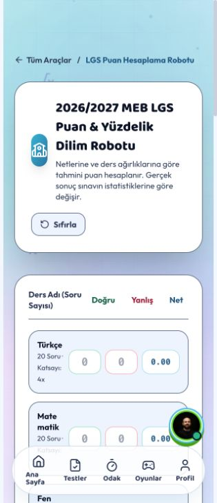
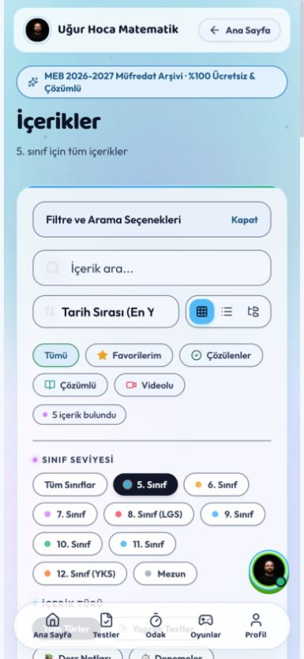
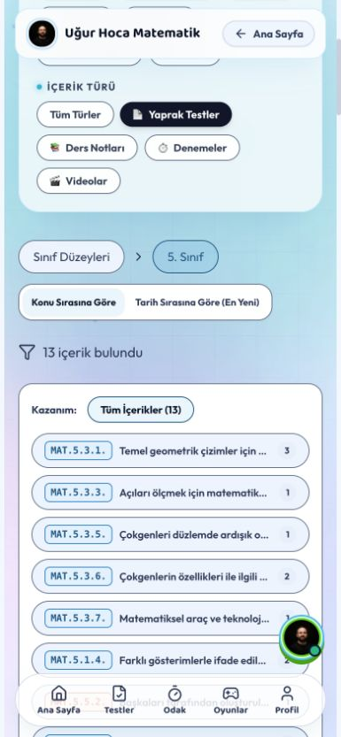
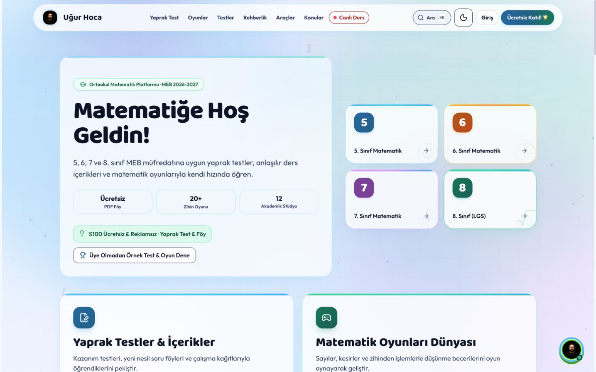

# Uğur Hoca — Site kalite denetimi ve düzeltme planı

Tarih: **16 Kasım 2026** · Hedef: **https://www.ugurhoca.com/**

## Sonuç

En önemli doğrulanmış işlev hatası, yaprak testlerde **geri tuşunun URL ile ekrandaki sınıfı ayırmasıdır**. Tek tıklamada aynı içerik hedefi için **iki RSC isteği ve bir HTML ön yüklemesi** de gözlendi; bu, üç tam sayfa açılışı anlamına gelmiyor. Mobilde mesaj balonu içerik ve form alanlarını örtebiliyor; dar ekranda LGS ders adları kelime ortasından bölünüyor. Filtreler, tekrar eden giriş noktaları ve sayfalar arasında değişen gezinme düzeni kullanım yükünü artırıyor.

Parlamanın tek bir kesin nedeni henüz belirlenmedi. Kodda rota geometrisiyle eşleşmeyen yükleme iskeletleri, sonradan gelen matematik metni ve istemci verisi gibi adaylar var. Bunlar aşağıda canlıda doğrulanmış kusurlardan ayrı işaretlendi.

**Bu teslim rapor ve plandır. Uygulama koduna, şemaya veya içeriğe düzeltme uygulanmadı.**

## Kapsam ve yöntem

- Codex uygulama içi tarayıcısında mevcut canlı sekme kullanıldı; oturum misafirdi.
- 390×844 ve 320×740 telefon görünümleri, 1440×900 masaüstü görünümü incelendi. Başlangıçtaki masaüstü görünümü de gözlendi.
- Ekran görüntüleri, erişilebilirlik/DOM ağacı, tarayıcı ağ olayları ve ilgili yerel kaynaklar karşılaştırıldı.
- Kaynak başlangıcı: yerel `main`, son commit `0e3156aa`. Canlı sürümün commit kimliği ayrıca doğrulanmadı; canlı gözlem ve yerel kod kanıtı bu yüzden ayrı tutuldu.
- Dar kapsamlı ikinci kaynak incelemesi, gezinme ve içerik önizleme koduyla sınırlandı.
- 13 ekran görüntüsü ve ölçüm özeti: [kanıt klasörü](../output/playwright/kalite-2026-11-16/), [ölçümler](../output/playwright/kalite-2026-11-16/olcumler.json).

**Kanıt türleri:** “Canlı” bu çalışmada tekrarlandı; “Kod” davranış kaynakta görüldü fakat ilgili kullanıcı senaryosu canlıda tamamlanmadı; “Ölçülecek” doğrulanmış bir hata iddiası değildir. P1 önce, P2 sonraki kalite turunda, P3 bakım/sadelik iyileştirmesidir.

## İncelenen akışlar

| Adım | Akış                                       | Durum ve kanıt                                                                                                                                                                                          |
| ---- | ------------------------------------------ | ------------------------------------------------------------------------------------------------------------------------------------------------------------------------------------------------------- |
| 1    | Ana sayfa, telefon                         | Açılıyor; uzunluk ve sabit katman yoğunluğu var. [01](../output/playwright/kalite-2026-11-16/01-ana-sayfa-mobil.jpg)                                                                                    |
| 2    | Ana sayfa → 5. sınıf içerikleri            | Tek tıklama çalışıyor; iki RSC + bir HTML ön yüklemesi kaydedildi. [02](../output/playwright/kalite-2026-11-16/02-icerikler-mobil.jpg)                                                                  |
| 3    | İçerik arama/filtre açılımı                | Çalışıyor; sonuçlar ilk ekranın dışına itiliyor. [03](../output/playwright/kalite-2026-11-16/03-filtre-acik-mobil.jpg)                                                                                  |
| 4    | Üyeliksiz deneme ve bir doğru cevap seçimi | Soru ve çözüm açılıyor; metin/erişilebilirlik iyileştirmeleri gerekli. [04](../output/playwright/kalite-2026-11-16/04-deneme-salonu-mobil.jpg)                                                          |
| 5    | Araçlar dizini                             | Açılıyor; üst gezinme diğer sayfalardan farklı. [05](../output/playwright/kalite-2026-11-16/05-araclar-mobil.jpg)                                                                                       |
| 6    | LGS hesaplayıcı, 390 ve 320 piksel         | Açılıyor; dar ekranda ders adları bölünüyor ve sabit balon alan örtebiliyor. [06](../output/playwright/kalite-2026-11-16/06-lgs-mobil.jpg), [07](../output/playwright/kalite-2026-11-16/07-lgs-320.jpg) |
| 7    | Testler → giriş yönlendirmesi              | `/giris?redirect=%2Ftestler` doğru oluştu; hesapla giriş yapılmadı. [08](../output/playwright/kalite-2026-11-16/08-giris-320.jpg)                                                                       |
| 8    | Yaprak test → 5. sınıf → tarayıcı geri     | **Hatalı:** URL tüm sınıflar, içerik hâlâ 5. sınıf. [09](../output/playwright/kalite-2026-11-16/09-geri-tusu-mobil.jpg)                                                                                 |
| 9    | Ana sayfa, masaüstü                        | Yerleşim açılıyor; efekt yoğunluğu yüksek. [10](../output/playwright/kalite-2026-11-16/10-ana-sayfa-masaustu.jpg)                                                                                       |
| 10   | Hızlı arama aç/kapat                       | İlk tıklamada açıldı; Escape ile kapandı. [11](../output/playwright/kalite-2026-11-16/11-hizli-arama-masaustu.jpg)                                                                                      |
| 11   | Koyu tema ve yenileme                      | Tema yenileme sonrası korundu; açık temaya geri dönüldü. [12](../output/playwright/kalite-2026-11-16/12-ana-sayfa-koyu.jpg)                                                                             |
| 12   | Mobil menü aç/kapat                        | 390×844 görünümünde çalıştı. [13](../output/playwright/kalite-2026-11-16/13-mobil-menu.jpg)                                                                                                             |

## Bulgular

### 1. P1 · Geri tuşu sınıf seçimini geri almıyor — Canlı + kod

**Tekrar:** `/icerikler?type=yaprak-test` → alttaki 5. sınıf kartı → `/icerikler?type=yaprak-test&grade=5` → tarayıcı geri. URL'den `grade` kalktı ve açıklama “tüm sınıflardaki içerikler” oldu; 5. sınıf kırıntısı, kazanımları ve **13 içerik** ekranda kaldı.

**Kaynak:** `matematik-platform/src/features/content/containers/ContentsPage/useWorksheetNavigation.ts:168-173`; geçerli `grade` yoksa efekt state'i sıfırlamadan çıkıyor.

**Düzeltme:** URL'yi sınıf/kazanım durumunun tek kaynağı yap; grade silinmesini açık bir sıfırlama geçişi olarak işle. Eski isteğin sonucu yeni ekranı ezmesin.

**Kabul:** Sınıf seç → geri → tüm sınıf kartları; ileri → aynı sınıf. Başlık, filtre, kırıntı ve liste her adımda URL ile aynı olmalı.

### 2. P1 · Geç gelen istek kapatılmış belgeyi yeniden açabilir — Kod

**Kaynak:** `.../ContentsPage/useContentPreview.ts:196-200`; `loadDocumentById()` sonucunda güncel belge id'si, istek sırası ve cleanup kontrolü olmadan `handleOpenPreview()` çağrılıyor. Aynı dosyada `:54` modalı, `:74-85` URL/geçmişi değiştiriyor.

**Etki:** Yavaş ağda A belgesi istenirken geri dönülürse veya B seçilirse, A'nın geç cevabı eski önizlemeyi yeniden açabilir. Kullanıcının “yine açılıyor” tarifine uygun bir adaydır; bu özel yarış canlıda kontrollü gecikmeyle tekrarlanmadı.

**Düzeltme:** Son istek kimliği veya iptal/cleanup koruması; sonucun hâlâ istenen id'ye ait olduğunu doğrulama; hata yakalama ve anlaşılır yeniden deneme.

**Kabul:** A yavaş/B hızlı, kapat/geri/ileri ve bağlantı hatası senaryolarında eski modal yeniden açılmamalı; görüntülenme tek kullanıcı açılışında bir kez sayılmalı.

### 3. P2 · Aynı hedefte iki ön yükleme sistemi — Canlı + kod

Tek 5. sınıf tıklamasında `/icerikler?grade=5` için sırasıyla RSC Fetch, HTML Prefetch ve ikinci RSC Fetch gözlendi. RSC sorgu anahtarları farklıydı. Bu örnekte yeni bir `Document` isteği görülmedi; **“sayfa üç kez açıldı” sonucu çıkarılamaz**.

**Kaynak:** `src/app/layout.tsx:131-168` document speculation rules; `src/components/SafeLink.tsx:67-95` hover/touch/focus `router.prefetch()`.

**Düzeltme:** SPA bağlantılarında tek ön yükleme sahibi belirle. HTML speculation ile RSC ön yüklemesini aynı bağlantıda yarışa sokma. RSC ön yükleme ile gerçek gezinme isteğini ayrı ölç; bütün ön yüklemeleri körlemesine kapatma.

**Kabul:** Fare, dokunma ve klavyede bir kullanıcı hareketi tek rota geçişi üretmeli; aynı amaçlı yinelenen istek olmamalı. Beklenen RSC protokol istekleri hata diye sayılmamalı.

### 4. P2 · Yükleme iskeleti rota geometrisini temsil etmiyor — Kod / etkisi ölçülecek

`src/components/RouteLoadingShell.tsx:17-35` her rotaya aynı üst menü ve altı kısa kart çiziyor. İçerik sayfasındaki büyük filtre alanı bu yapıda yok (`.../ContentsPage/ContentsView.tsx:31-65`). Giriş formu ve araç ekranları da farklı geometriler kullanıyor.

**Etki:** İskelet → gerçek başlık/filtre → veri değişimi, sayfa tekrar kuruluyormuş hissi verebilir. Mevcut “birebir geometri” yorumu tüm rotalar için geçerli değil. Bu akışın CLS değeri ölçülmedi.

**Düzeltme:** İçerik, form ve araç için gerçek boyutları paylaşan iskeletler; sabit sayfa çerçevesi. Hızlı geçişte gereksiz kısa iskelet gösterimini engelle; yavaş geçişte mevcut ekranı bir anda boşaltma.

### 5. P2 · Yaprak test derin bağlantısı veriyi hidrasyon sonrasında getiriyor — Kod

`src/app/icerikler/page.tsx:41-48` yaprak test türünde boş başlangıç verisi ve `isHydrated:false` veriyor. Sınıf verisi `useWorksheetNavigation.ts:176-181` istemci efektiyle yükleniyor.

**Düzeltme:** Seçili sınıf bağlantısına uygun başlangıç verisini sunucuda hazırlama veya tek, kararlı yükleme durumu kullanma; başlangıç verisini istemcide yeniden istememe.

**Korunacak davranış:** `useContentFeed.ts:221-242` başarılı ve filtrelerle eşleşen SSR verisinde tekrar isteği zaten engelliyor. Genel olarak “bütün içerikler iki kez çekiliyor” iddiası doğru değil.

### 6. P1 · Mesaj balonu form ve soru alanlarını örtebiliyor — Canlı

[320 piksel LGS](../output/playwright/kalite-2026-11-16/07-lgs-320.jpg) görünümünde balon matematik satırının sağ tarafını; deneme salonunda soru metninin sağ alt bölümünü örttü. Alt menü de aynı ekranın altında sürekli alan kullanıyor. Balon ile alt menü birbirine doğrudan binmiyor; esas sorun **alttaki içerikle örtüşmeleri**.

**Kaynak:** `src/components/ChatBubble/ChatBubbleTrigger.tsx:31`, `src/components/MobileBottomNav.tsx`.

**Düzeltme:** Form/soru/oyun ekranlarında balonu küçült, uygun bir destek girişine taşı veya kapatılabilir yap. Odaklanan alanları ve ana eylemleri sabit katmanlardan koru. Alt menü için gerçek yüksekliğe uygun rezerv boşluk kullan.

**Kabul:** 320/360/390 pikselde formun son alanı, soru şıkları ve ana eylem tamamen görülebilmeli; fiziksel telefonda klavye açıkken de doğrulanmalı.

### 7. P2 · Dar ekranda LGS ders adları kelime ortasından bölünüyor — Canlı + kod

320 pikselde “Matematik”, “Mate / matik” biçimine; ders alt açıklaması birkaç kısa satıra bölündü. Yatay taşma olmaması bu okunabilirlik sorununu çözmüyor.

**Kaynak:** `src/features/tools/containers/LgsCalculatorContainer.tsx:154-199`: solda sıkışabilen metin, sağda sabit genişlikli üç alan; başlıkta `break-words`.

**Düzeltme:** Dar ekranda ders adı üstte, doğru/yanlış/net alanları altta düzeni; masaüstünde mevcut satır korunabilir. Alanların kendi etiketleri bulunmalı.

**Kabul:** 320 pikselde ders adları doğal sözcük sınırlarıyla okunmalı; yüzde 200 yakınlaştırmada değer ve etiket ilişkisi korunmalı.

### 8. P2 · Mobil filtreler ilk sonucu gereğinden fazla aşağı itiyor — Canlı

390 pikselde kapalı arama panelinde dahi sınıf/tür seçenekleri görünür; ilk kart alt menünün arkasından başlıyor. Arama açıldığında sıralama, görünüm ve hızlı filtrelerle sonuç daha da aşağı gidiyor. “Filtre ve Arama Seçenekleri” düğmesi bütün filtreleri değil yalnız bir bölümünü açıyor.

**Kaynak:** `ContentFilters.tsx:130` sonrası sınıf/tür çipleri, `ContentFilterBar.tsx:62-76` açılır alanın dışında.

**Düzeltme:** Etkin filtre özeti ve tek filtre paneli; aramaya doğrudan erişim; gelişmiş görünüm seçeneklerini ikinci düzeye taşıma. Düğme adı ve kapsadığı alan tutarlı olmalı.

### 9. P2 · Sınıf seçimi aynı sayfada iki kez sunuluyor — Canlı

Yaprak testlerin başlangıcında üstte sınıf çipleri, altta dokuz sınıf kartı var. Kullanıcı aynı kararı iki farklı yerde görüyor. Başka içerik türüne geçilince davranış da değişiyor.

**Düzeltme:** Sınıf seçimi için tek bir ana kontrol; diğer yerde yalnız seçimi gösteren özet/kırıntı. Lise/mezun seçeneklerini gerçek içerik kapsamı ve hedef kitleye göre düzenle; veri varlığını doğrulamadan kaldırma.

### 10. P2 · Sayfalar arasında üst gezinme değişiyor — Canlı + kod

Ana sayfa tam menü, içerikler logo + ana sayfa/profil, araçlar yalnız geri bağlantısı, deneme salonu ana sayfa + kayıt kullanıyor. Arama ve tema erişimi aynı yerde kalmıyor. Mobil alt menüde İçerikler/Araçlar bulunmuyor.

**Kaynak:** `HomeNavbar.tsx`, `ContentNavigation.tsx`, `src/app/araclar/page.tsx`, `src/app/deneme-salonu/page.tsx`.

**Düzeltme:** Ortak ve hafif bir üst çerçeve; aktif bölüm, geri yolu, arama ve tema için tutarlı yer. Test/oyun gibi odak akışlarının özel çerçevesi açık bir kurala bağlanmalı.

### 11. P2 · Ana sayfa mobilde çok uzun ve giriş noktaları tekrar ediyor — Canlı

390×844 ölçümünde belge yüksekliği **11.063 piksel**, yaklaşık 13 ekran. Masaüstünde 6.090 piksel. Sınıf kartları, içerik vitrini, oyunlar, akademik araçlar, haftalık müfredat, nasıl çalışır, haberler, sayaçlar, söz ve destek ardışık geliyor. Ücretsiz kullanım vurgusu birçok yerde tekrarlanıyor.

**Düzeltme:** Sınıf seçimi ve son içerikleri öne çıkar; ikincil modüllere kısa özet ve ilgili sayfaya bağlantı ver. Mobilde tek ana görev çevresinde hiyerarşi kur. İçeriği rastgele silme.

### 12. P2 · Efekt yoğunluğu ve sürekli arka plan çizimi — Canlı + kod / hız etkisi ölçülecek

Masaüstü ana sayfada boyutu olan **113 DOM elemanında** `backdrop-filter` hesaplandı; bu sayı hepsinin aynı anda ekranda çizildiği anlamına gelmez. Bir canvas arka planı da mevcut. Çok sayıda cam yüzey, renkli üst şerit, gölge ve ışık odağı görsel kalabalık oluşturuyor.

**Kaynak:** `SiteBackground.tsx:156-245,290-344`, `globals.css` cam yüzey kuralları.

**Düzeltme:** Önce düşük güçlü cihazda paint/composite/scroll ölçümü; ardından aynı tasarımı koruyarak blur ve gölgeleri ortak katmanlarda azaltma. Statik arka planı mobil/veri tasarrufu için değerlendirme. İmleç efektini ilgili cihazlarla sınırlandırma.

**Korunacaklar:** Arka plan zaten görünmeyen sekmede duruyor, kaydırmada çizimi atlıyor ve azaltılmış harekette tek kare çiziyor. Bunları eksikmiş gibi yeniden geliştirmemek gerekir. Sürekli animasyonun pil/FPS etkisi bu denetimde ölçülmedi.

### 13. P2 · Matematik metni sonradan “...” yerine geliyor — Kod / parlama adayı

`GuestQuestionCard.tsx:17-20` MathText'i `ssr:false` ve `animate-pulse` üç nokta ile yüklüyor. Soru gövdesi ve seçenekler bu bileşeni kullanıyor. Metin yüklenmesiyle satır yüksekliği değişebilir; canlı CLS miktarı ölçülmedi.

**Düzeltme:** Düz metni hemen göster; matematik içeren kısımları gerektiği yerde yükle veya uygun sunucu çıktısı sağla. Gerçek soru alanını koruyan yer tutucu kullan; okunabilir soruyu dekoratif titreşimle değiştirme.

### 14. P2 · Deneme salonunda cevap durumu ve boş alan bildirimi eksik — Kod + DOM

Çoktan seçmeli seçeneklerde seçili/doğru/yanlış durumları sınıflarla veriliyor; düğmelerde `aria-pressed`/eşdeğer durum yok. Doğru cevap denemesinde çözüm açıldı, DOM'daki seçenek adı yine “C 60” kaldı. Kısa cevap boşsa `handleEvaluateShort()` sessizce dönüyor (`GuestQuestionCard.tsx:37-45`). Girdide kalıcı etiket yerine placeholder var.

**Düzeltme:** Görsel renge ek olarak doğru/yanlış metni ve erişilebilir durum; uygun canlı geri bildirim; kalıcı cevap etiketi ve “Önce cevabını yaz” bildirimi. Çözüm görüldükten sonra cevabı değiştirme davranışını açıkça tanımla.

**Kabul:** Klavye ve ekran okuyucuyla soru → seçim → sonuç → çözüm sırası anlaşılır olmalı. Boş cevaba açık geri bildirim verilmeli.

### 15. P2 · LGS net gösterimi kendi açıklamasıyla tutarsız — Kod

Görünen açıklama neti `doğru − yanlış/3` diye tanımlıyor. Buna karşılık `LgsCalculatorContainer.tsx:151` ve `src/lib/examCalculators.ts:154-155` negatif sonucu sıfıra kırpıyor. Örneğin 0 doğru/3 yanlış için açıklamadaki işlem −1, uygulamadaki sonuç 0.

**Düzeltme:** Ham net ile tahmini puan modelinin alt sınırını ayır. Ders ve toplam net, açıklanan formülle tutarlı olmalı; puan modelindeki sınırlar ayrıca anlatılmalı. Resmî hesaplama eşdeğerliği bu incelemede araştırılmadı ve iddia edilmiyor.

**Kabul:** 0/3, tüm boş, tüm doğru ve doğru+yanlış sınırı için formül, ders neti, toplam ve diğer hesaplayıcı yüzeyleri aynı kurala uymalı.

### 16. P3 · Yıl ve SSS kaynakları tekrarlanıyor — Canlı + kod

LGS sayfa başlığı 2026/2027, sekme/metaveri başlığı 2026. Route dosyası iki soruluk SSS JSON-LD, container dört soruluk başka bir SSS JSON-LD üretiyor (`.../lgs-puan-hesaplama/page.tsx:7,19-41`, `LgsCalculatorContainer.tsx:25-75`).

**Düzeltme:** Yıl/sezon ve SSS tek kaynaktan üretilecek. Görünen sorular ile yapılandırılmış veri uyumlu kalacak. Bu bulgu tek başına arama motoru cezası olduğu anlamına gelmez.

### 17. P3 · Ürün metninde teknik dil ve terminoloji karışıyor — Canlı + kod

Deneme salonunda “LaTeX çözümleri”, içerik görünümünde “Kılavuz Görünümü” (grid), “İncele/Önizle” ve “Konular/İçerikler/Yaprak Testler” farklı bağlamlarda kullanılıyor. Öğrenci açısından bu ayrımların bir kısmı belirsiz.

**Düzeltme:** “Adım adım çözüm”, “Kart görünümü”, “Önizle” gibi görev odaklı tutarlı adlar. İçerik açıklamalarındaki üretim şablonu adlarını öğrencinin ihtiyacından ayır.

### 18. P2 · Tasarım dokümanı ile uygulama birbirini tutmuyor — Kod

`docs/web-kalite-ve-profesyonellik-plan.md:8` Fraunces/Plus Jakarta Sans/JetBrains Mono diyor; aynı dosyanın `:116-121` kararında Baloo 2/Outfit yazıyor. Sıcak Kağıt zemini #FAF8F5 olarak anlatılırken canlıdaki yüzey tokenı **242 247 254**, yani #F2F7FE. `layout.tsx:2` Outfit/Baloo 2 kullanıyor; `globals.css:220` mevcut yüzeyi doğruluyor.

**Düzeltme:** Önce mevcut uygulanmış tasarımın yetkili kaydını netleştir; tokenlar ve doküman bunu izlesin. Bu rapor görsel tasarımı kendiliğinden değiştirme talebi değildir. Çelişki bırakılırsa sonraki düzeltmeler farklı tasarım dillerini yeniden karıştırır.

### 19. P2 · Açılır filtre durumunun erişilebilir bildirimi eksik — Kod

`ContentFilterBar.tsx:62-73` düğmesinde `aria-expanded` ve `aria-controls` yok. “Aç/Kapat” metni değişse de bağlı panel ve durum programatik olarak tanımlanmıyor.

**Düzeltme:** Panel id'si, açılma durumu ve uygun odak davranışı. Gizli kontroller klavye sırasına girmemeli. Normal metin/denetim kontrastı ayrıca ölçülmeli; bu inceleme WCAG uygunluk belgesi değildir.

## Hız ve kararlılık ölçümü

Tek **önbellekli masaüstü ana sayfa yenilemesi**:

| Ölçüm                       |                    Sonuç |
| --------------------------- | -----------------------: |
| İlk yanıt başlangıcı (TTFB) |                   104 ms |
| DOMContentLoaded            |                   172 ms |
| Load                        |                   242 ms |
| İlk içerik boyaması (FCP)   |                   274 ms |
| Gözlenen LCP                |          yaklaşık 274 ms |
| Gözlenen CLS                |                        0 |
| Gözlenen uzun görev         |                        0 |
| Script resource kaydı       |                       20 |
| Script transferSize toplamı | 0 bayt; önbellekli örnek |

Bu sonuç **ilk ziyaret, mobil 4G, fiziksel telefon veya gerçek kullanıcı p75 verisi değildir**. Script transferSize=0, JS paketinin sıfır boyutta olduğu anlamına gelmez. Performans gözlemcileri yenileme sonrasında buffered kayıtlarla okundu; ilk kullanıcı etkileşimi LCP gözlem penceresini sonlandırır.

İncelenen konsol kayıtlarında hata/uyarı görünmedi. Yenilemenin ağ olay tamponunda `truncated=true` olduğu için bütün isteklerin eksiksiz incelendiği veya sıfır ağ hatası bulunduğu iddia edilmiyor.

Örneklenen içerik sayfasında bozuk görsel bulunmadı. Ana sayfa/içerik/LGS ölçümlerinde genel yatay sayfa taşması görülmedi; LGS'de sözcük bölünmesi ve sabit katman örtüşmesi yine de var. Koyu tema yenilemede korundu; kalıcı beyaz ekran veya zorunlu tekrar tıklama bu örneklerde görülmedi.

## Uygulanacak düzeltme sırası

| Aşama                              | İş ve sınır                                                                                    | İlgili bulgular        | Teslim kapısı                                                                       |
| ---------------------------------- | ---------------------------------------------------------------------------------------------- | ---------------------- | ----------------------------------------------------------------------------------- |
| 1 — Durum ve tekrar açılma         | URL/state senkronu, geri/ileri, önizleme isteği yarışı. Önce gerçek işlev hataları.            | 1, 2                   | Geri/ileri ve gecikmeli cevap senaryoları geçer; eski belge açılmaz.                |
| 2 — Tek yükleme ve kararlı çerçeve | Prefetch sahipliği, rota özel iskelet, yaprak test başlangıç verisi, matematik metni.          | 3, 4, 5, 13            | Tek tıklama izi; gereksiz aynı amaçlı istek yok; gözle görülür boşalma/parlama yok. |
| 3 — Mobil kullanılabilirlik        | Balon/alt menü rezerv alanı, LGS satır düzeni, filtre paneli, tek sınıf seçimi.                | 6, 7, 8, 9             | 320/360/390/768 piksel; yüzde 200 yakınlaştırma; gerçek klavye açık denemesi.       |
| 4 — Öğrenme doğruluğu ve erişim    | Net formülü, boş cevap, seçili durum, etiketler, filtre erişilebilirliği.                      | 14, 15, 19             | Formül sınır testleri, klavye/ekran okuyucu, erişilebilir geri bildirim.            |
| 5 — Sadelik ve tutarlılık          | Ortak gezinme, ana sayfa hiyerarşisi, efekt bütçesi, metin ve kaynak tekilleştirme.            | 10, 11, 12, 16, 17, 18 | Önce mevcut tasarım kararı net; ekran karşılaştırması; ölçülen hızda gerileme yok.  |
| 6 — Kapanış                        | Aynı senaryoların temiz ve dolu önbellekte tekrar ölçümü; hesaplı akışlar ve cihaz denemeleri. | Tümü                   | Kalan açıklar açıkça yazılır; canlı ve yerel sonuçlar ayrı raporlanır.              |

Her aşama küçük ve geri alınabilir bir değişiklik grubu olmalı. Tema tokenları korunmalı; yeni özellik, yeniden tasarım veya şema değişikliği bu planın varsayılan kapsamı değil. Süre tahmini verilmedi: hesaplı akışlar, yavaş ağ izleri ve canlı sürüm eşleşmesi doğrulanmadan kesin gün/saat güvenilir olmaz.

## Doğrulama matrisi ve hedefler

1. **İlk ziyaret / tekrar ziyaret:** temiz önbellek, dolu önbellek ve service worker kontrolündeki ziyaret ayrı ölçülecek. Service worker kapatılarak yapılan kıyas sonuçları kalıcı ayar değişikliğine dönüşmeyecek.
2. **Bağlantı türü:** fare hover+tık, dokunma, klavye Enter ve art arda tıklama. Tek mantıksal gezinme; aynı id'nin görüntülenmesi tek kez sayılacak.
3. **Geçmiş:** sınıf, kazanım, tür, arama, önizleme aç/kapat, geri/ileri, derin bağlantı ve yenileme. URL, başlık, filtre ve veri birlikte kalacak.
4. **Yarış:** A yavaş/B hızlı, kapatmadan önce cevap gelmemesi, hata/timeout ve yeniden deneme. Eski sonuç uygulanmayacak.
5. **Parlama:** açık/koyu temada ilk yükleme, SPA geçişi, modal, matematik metni ve font yüklenmesi için film şeridi alınacak. 60 fps kayıt hızlı parlamayı teşhis etmek için kullanılacak; tek ekran görüntüsünden yokluğu kanıtlanmayacak.
6. **Mobil:** 320/360/390/768/1024/1440 genişlik, yüzde 200 yakınlaştırma, iOS Safari/Android Chrome, portre/yatay, safe-area ve klavye. Örtülü alan veya eylem olmayacak.
7. **Performans:** soğuk/ılık koşullarda en az üç tekrarlı laboratuvar örneği; varsa gerçek kullanıcı p75 verisi. Hedef bütçe: LCP ≤2,5 sn, INP ≤200 ms, CLS ≤0,1. Bunlar mevcut sitenin ölçülmüş p75 sonuçları değil, kabul hedefleridir.
8. **Hareket/scroll:** azaltılmış hareket, veri tasarrufu, düşük güçlü cihaz, arka plandaki sekme ve 30 saniye kaydırma. Uzun görev/paint/composite kaydıyla efekt kararları verilecek; ölçüm olmadan FPS garantisi verilmeyecek.
9. **Formlar:** boş, negatif, ondalıklı ve sınırı aşan sayı; doğru+yanlış toplamı; hata odağı; geri bildirim. Giriş/kayıt için test hesabı ve test ortamı kullanılacak.
10. **Erişilebilirlik:** klavye odağı, modal odak kapanı ve geri dönüşü, etiketler, canlı sonuçlar, renk dışı durum bilgisi; metin ve bileşen kontrast ölçümü.
11. **Dosyalar ve içerik:** tüm PDF/kapak bağlantılarında HTTP durumu, açılma/indirme davranışı ve bozuk görsel kontrolü. Paylaşılacak materyal gizlilik filtresi ve soru özgünlüğü ayrıca denetlenecek; yalnız başlık benzerliğinden mükerrer soru sonucu çıkarılmayacak.
12. **Mevcut proje kapıları:** uygulama değişikliğinde ilgili birim/E2E senaryoları, `npm run typecheck`, `npm run lint`; değişikliğe göre `npm run test:fast` ve `npm run build`. Başarılı kapılar yeni değişiklik yokken gereksiz tekrarlanmayacak.

## Bu çalışmada tamamlanan kontroller ve sınırlar

- `npm run typecheck` → **exit 0** (`tsc --noEmit`).
- `npm run lint` → **exit 0** (`eslint .`).
- Uygulama kodu değişmedi; birim test paketi ve üretim build'i bu rapor için çalıştırılmadı. Bu nedenle “tüm testler geçti” veya “üretim tamamen doğrulandı” denmiyor.
- Hesapla giriş, öğrenci izolasyonu, admin, ödevler, sonuç kaydı, gerçek canlı ders, tam oyun oturumu ve tüm PDF içerikleri denetlenmedi. Bu rapor tam güvenlik veya tüm müfredat doğruluğu denetimi değildir.
- İlk ziyaret çerez bildirimi, yavaş mobil ağ, gerçek telefon klavyesi ve kapsamlı kontrast taraması açık doğrulama işleridir.
- Tasarım yönlendirme dosyasının verilen `~/Desktop/model_görevleri/ROUTING.md` konumu bulunamadı. Eski model tabloları karar kaynağı olarak kullanılmadı.
- Kullanıcının başlangıçtaki açık teması ve tarayıcı boyutu geri yüklendi; test gözlemcileri sayfa yenilenmesiyle kaldırıldı.

## Görsel kanıtlar

### Dar ekranda LGS formu

“Matematik” kelimesinin bölünmesi ve sağdaki mesaj balonunun alan örtmesi:

### Açılmış mobil filtreler

Arama/sıralama/çipler görünürken ilk sonuç ekranın çok altında kalıyor:

### Geri tuşundan sonra kalan sınıf ekranı

Bu görüntü alınırken URL `/icerikler?type=yaprak-test` idi; görünüm 5. sınıfın 13 içeriğinde kaldı:

### Masaüstü genel görünüm

Mevcut tasarım referansı; düzeltmelerde istemeden görsel değişiklik yapılmasını önlemek için saklandı:

